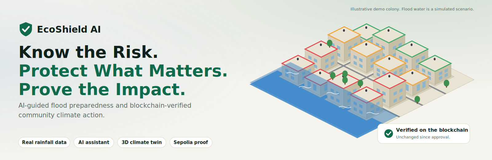
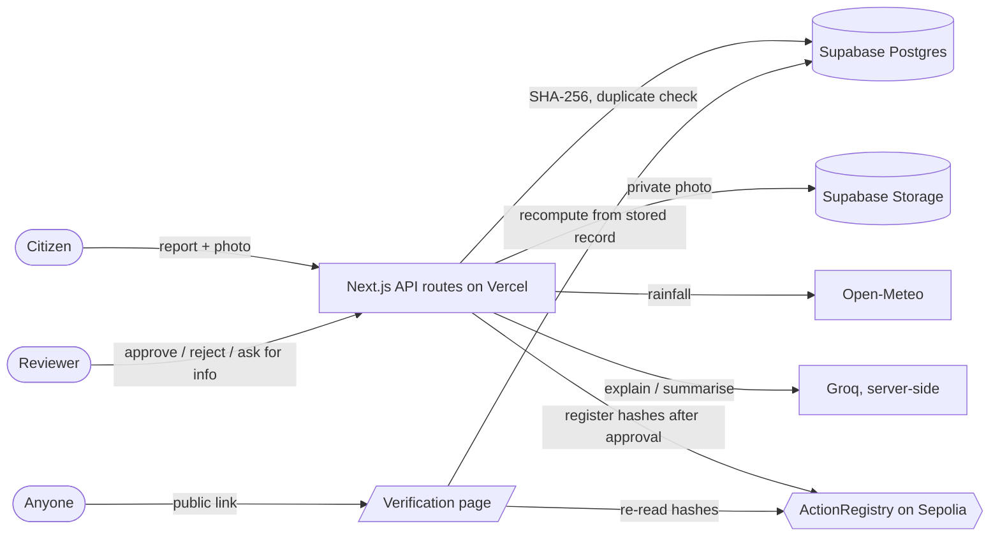

<p align="center">
  
</p>

<p align="center">
  <a href="https://YOUR-APP.vercel.app"><b>Live demo</b></a> ·
  <a href="https://YOUR-VIDEO-LINK"><b>Demo video</b></a> ·
  <a href="docs/DEMO-SCRIPT.md">Demo script</a> ·
  <a href="docs/DEPLOY.md">Deploy guide</a> ·
  <a href="docs/SUBMISSION.md">Submission text</a>
</p>

<p align="center">
  
  
  
  
  
  
</p>

# EcoShield AI

**Know the risk. Protect what matters. Prove the impact.**

EcoShield AI is a climate-resilience web app built for the **IEEE ClimateChain Global Hackathon 2026**. It helps ordinary people understand flood preparedness in their neighbourhood, report problems and community climate actions with photo evidence, and create a **public, tamper-evident record** of the actions a human reviewer approves.

> **The one-sentence story:** a citizen reports a blocked drain, AI helps analyse it, a reviewer approves it, the evidence fingerprint is registered on a blockchain, and anyone can open a public page that proves the evidence has not changed.

## Why this exists

- Flood risk information is hard for ordinary people to read, and cities rarely give clear, local, practical guidance.
- Community climate work (clean-ups, drain clearing, tree planting) is hard to trust: photos can be reused, edited or disputed.
- EcoShield AI keeps each part honest: real data where it exists, simulations clearly labelled, AI that only advises, humans who decide, and a blockchain used for exactly one job, **integrity of approved evidence**.

## What is real and what is simulated

| Real | Simulated (always labelled in the app) |
|---|---|
| 7-day rainfall and river-discharge forecasts from Open-Meteo, with source and time | The 3D colony: layout, ground heights, preparedness levels, flood-scenario water |
| Reports, photos, SHA-256 hashes, duplicate warnings, reviewer decisions, audit trail | The rainfall indicator is a simple, published rule, not a flood model or an official warning |
| AI explanations from Groq (labelled sample answers if no key or the service is down) | Demo accounts are shared and have no passwords |
| Blockchain registration on the **Sepolia test network**: a real transaction you can open on Etherscan | |

> A blockchain record proves that evidence was **unchanged after approval**. It does **not** prove the reported claim is true: that is what human review is for. The AI never approves, certifies or guarantees anything, and the app never shows "verified" unless a confirmed transaction exists and the hashes still match.

## Features

| | |
|---|---|
| **Climate dashboard** | Real rainfall outlook per neighbourhood, interactive daily chart, wettest-first comparison of all areas, source and update time, uncertainty notes |
| **AI assistant** | Plain-language explanation, preparedness checklist, "why this advice", report summaries and missing-information checks. Server-side only, labelled demo mode as fallback |
| **3D climate twin** | Explorable colony with clickable buildings, flood-risk and preparedness layers, an illustrative rising-water scenario, building panel, keyboard-friendly list view |
| **Community reports** | Categories, photo evidence (JPEG/PNG/WebP, 4 MB), SHA-256 fingerprint, duplicate warnings (same file or similar wording), status stepper, filters |
| **Human review** | Approve, reject, or **request more information** (the author replies and the report returns to the queue), full audit history |
| **Blockchain proof** | Solidity `ActionRegistry`: one registration per ID, hashes only, confirmation status, re-check on every view |
| **Public verification** | Shareable `/verify/ID` page with five clear states, in-browser file check (the file never leaves your device), privacy-safe fields only |
| **Safety and trust** | Emergency numbers and official alert links, About / Privacy / Terms pages, reviewer passcode, rate limits, private photos |

## How it works



Report lifecycle: `pending` → (`needs_info` ⇄ `pending`) → `approved` → `registered`, or `rejected`. The blockchain stores only the report ID, a SHA-256 of the photo and a SHA-256 of the canonical record. No photos, no text, no personal data.

## Tech stack

| Layer | Choice |
|---|---|
| Frontend | Next.js (App Router), React, TypeScript (strict), Tailwind CSS |
| 3D | three.js via React Three Fiber; merged geometry keeps the scene at roughly 90 draw calls |
| Backend | Next.js route handlers (serverless, no always-on server) |
| Data | Supabase Postgres + private Storage (row-level security on, server-side access only) |
| AI | Groq chat completions, called only from server code |
| Chain | Solidity 0.8.26, Hardhat tests, ethers v6, Sepolia testnet |
| Weather | Open-Meteo forecast and flood APIs (no key) |
| Hosting | Vercel free tier; no paid backend required |

## Quick start

```bash
git clone <this repository>
cd ecoshield-ai
npm install
cp .env.example .env.local     # fill in the values (table below)
npm run dev                    # http://localhost:3000
```

1. In the Supabase SQL Editor run, in order: `supabase/schema.sql`, `supabase/phase4.sql`, `supabase/phase11.sql`, `supabase/phase12.sql`. If you see "permission denied", run the grants in [docs/DEPLOY.md](docs/DEPLOY.md).
2. Deploy `contracts/src/ActionRegistry.sol` to Sepolia (steps in [contracts/README.md](contracts/README.md)) and put its address in `.env.local`.
3. Open the app, choose **Enter the demo**, and log in as **Citizen**, or as **Reviewer** with `REVIEWER_PASSCODE`.

The app degrades gracefully: without Supabase it shows labelled seed data (reports cannot be saved); without a Groq key the AI runs in labelled demo mode; without the chain variables the Register button explains that the chain is not configured.

### Environment variables

| Name | Secret | Purpose |
|---|---|---|
| `NEXT_PUBLIC_SUPABASE_URL` | no | database and storage |
| `NEXT_PUBLIC_SUPABASE_ANON_KEY` | no | reserved (not used by current code) |
| `SUPABASE_SERVICE_ROLE_KEY` | **yes** | server-side database access |
| `SESSION_SECRET` | **yes** | signs the demo session cookie. **Required in production** |
| `REVIEWER_PASSCODE` | **yes** | Reviewer demo login. **Required in production** (reviewer login is off without it) |
| `GROQ_API_KEY` / `GROQ_MODEL` | **yes** / no | live AI (optional) and model override |
| `SEPOLIA_RPC_URL` | no | blockchain reads and writes |
| `REGISTRY_CONTRACT_ADDRESS` | no | deployed `ActionRegistry` |
| `REGISTRAR_PRIVATE_KEY` | **yes** | testnet-only wallet that signs registrations. A hot wallet: never put real funds in it |
| `CHAIN_ID` | no | optional, defaults to Sepolia (11155111) |

Secrets are only read in server code and are never prefixed with `NEXT_PUBLIC_`. Deployment steps for Vercel are in [docs/DEPLOY.md](docs/DEPLOY.md).

## Testing

```bash
npm test                                   # 11 suites, see below
REVIEWER_PASSCODE=... BASE_URL=http://localhost:3000 npm run a11y    # axe-core scan of 16 pages
REVIEWER_PASSCODE=... BASE_URL=https://your-app.vercel.app npm run smoke   # post-deploy checks
```

`npm test` covers rainfall parsing and the indicator, report validation, duplicate detection, AI prompts and fallbacks (with a mocked `fetch`), verification verdicts and redaction, session signing and passcodes, rate limiting, review-state logic, the 3D data, geometry and scene graph, WCAG contrast of the palette, and **the real SQL migrations run in an in-process Postgres (PGlite)**. The contract has 7 Hardhat tests, and the chain library is exercised against a local Hardhat node (`scripts/test-chain.ts`).

**What is not covered by automated tests:** the full flow against live Supabase, Groq and Sepolia, real browsers and phones, and 3D frame rate. Use [docs/E2E-CHECKLIST.md](docs/E2E-CHECKLIST.md) for those, and read [docs/AUDIT-NOTES.md](docs/AUDIT-NOTES.md) for the honest status of every feature.

## Security model (demo level)

- Reviewer access needs a shared passcode; login attempts and the sensitive routes (upload, AI, register, review, reply) are rate limited per IP through a SQL function, with an in-memory fallback.
- Photos can only be opened by reviewers and by the demo session that uploaded them. Public pages show hashes only, never photos, authors or reviewer notes; emails and long numbers in descriptions are hidden.
- All secrets stay on the server (checked: no secret names in the client bundle). Uploads are checked by file signature, not only by type.
- Not done yet: real accounts, EXIF/GPS stripping of photos, a Content-Security-Policy header, session revocation.

## Project layout

```
src/app/            pages and API routes (auth, reports, review, reply, register, ai, status, verify, info pages)
src/components/     ui, layout, dashboard, reports, ai, chain, verify, profile, twin (3D)
src/lib/            session, db, climate, ai, chain, hashing, duplicates, rate limiting, verification logic
src/data/           neighbourhoods and the simulated 3D colony
supabase/           schema.sql, phase4.sql, phase11.sql, phase12.sql
contracts/          ActionRegistry.sol, Hardhat tests, deploy script
scripts/            tests, accessibility scan, contrast check, smoke test, banner generator in docs/assets
docs/               DEPLOY, E2E checklist, demo script, submission text, audit notes
```

## Known limitations

- Three demo areas; rainfall and river data only (no heat); shared demo accounts with no real sign-up.
- Photos: JPEG, PNG or WebP up to 4 MB (Vercel's request limit is 4.5 MB). The AI reads text only.
- No 2D map, notifications, edit/withdraw, or resolution workflow yet.
- The registrar key is a hot wallet in an environment variable: fine for a testnet demo, not for production.
- Free public RPCs are rate-limited, and free Supabase projects can pause when idle. Wake yours before judging.

## Roadmap

Real flood-hazard datasets and heat risk · 2D map with report markers · real accounts and an admin console · wallet-signed submissions · in-app notifications and a resolution workflow · EXIF stripping and a CSP header.

## Credits

Weather data by [Open-Meteo.com](https://open-meteo.com/) (CC BY 4.0). Built with Next.js, Supabase, Groq, three.js, ethers and Hardhat. The smart contract is MIT-licensed (see its SPDX header). EcoShield AI is a hackathon prototype and **not an emergency service**: in danger, call your local emergency number (see the app's Emergency resources page).
